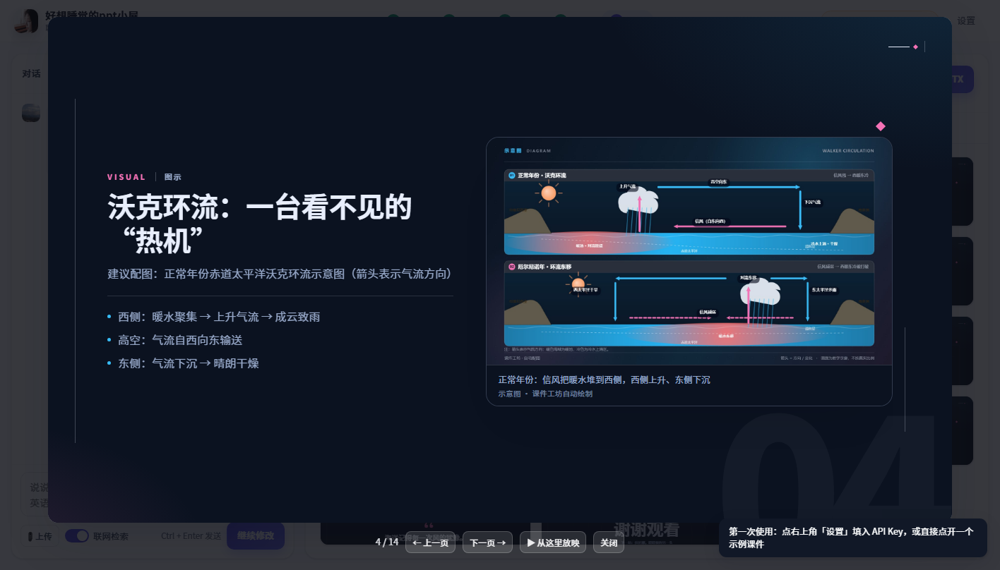
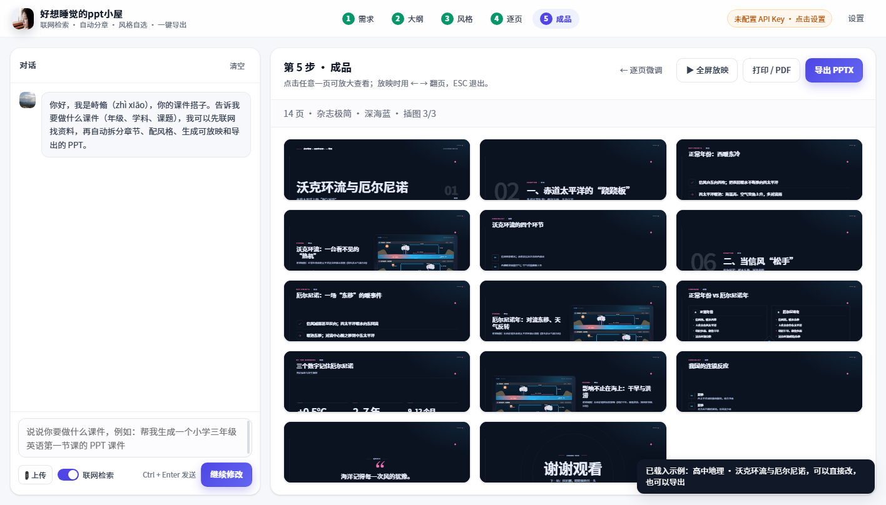

# 《好想睡觉的ppt小屋》拆解报告 & 增强克隆说明

> 拆解对象：<https://cet4listening.github.io/ppt-ai/>
> 克隆产物：`ppt-ai-pro/`（独立目录、独立端口，与原站互不影响）
> 在线地址：<https://zhixiao-xjy.github.io/ppt-ai-pro/>
> 验证环境：Windows + Edge Headless（CDP）+ 本地静态服务器，2026-11

---

## 0. 一句话结论

原站是一个**纯静态、零后端、零构建**的「对话式 PPT 生成器」：用户在左侧说需求，右侧依次完成「需求 → 大纲 → 风格 → 逐页 → 成品」，最后由浏览器直接调用 OpenAI 兼容接口生成 JSON 课件，并用本地 `PptxGenJS` / `html2canvas` 导出 `.pptx`。

它的产品流程和视觉完成度都很高，但有一个会直接毁掉交付物的缺陷：**当模型返回了带 `caption` 的 `image` 页、而用户没有上传图片时，页面会渲染一个“图片占位 / 在编辑区上传 / 选择一个素材”的空框，导出的 PPTX 里则写“（未提供图片）”。** 这正是需求截图里的情况。

克隆版保留原站的界面、流程、主题与导出能力，在此基础上补上：

1. **无图自动配图**：9 类教学示意图模板，按页面主题用 Canvas 绘制，离线可用；
2. **三套免 Key 示例课件**：高中地理·沃克环流、小学英语·Hello、初中物理·光的折射；
3. **渲染 / 导出 / 编辑三处兜底**：任何情况下都不再出现“图片占位 / 未提供图片 / 图片无法嵌入”；
4. **存储配额保护**：自动图不写入 localStorage，刷新后按需重绘；
5. **可视化配图状态**：大纲里显示「自动配图 / 网络图 / 已配图 / 待配图」，支持单页重绘和一键补全。

---

## 1. 产品定位与目标用户

| 维度 | 判断 |
| --- | --- |
| 一句话定位 | 给老师/教研者的「一句话生成可讲课件」工具 |
| 核心用户 | 中小学教师、师范生、需要做分享/微课的人 |
| 核心场景 | 临时被安排公开课、缺课件；想把教案快速变成能放映的 PPT |
| 差异点 | 不生成“大纲文本”，而是直接生成**可放映、可导出、带讲稿**的整套课件 |
| 商业属性 | 开源静态站，用户自带模型 Key，无账号、无后端、无付费墙 |

原站最聪明的一点：**把“AI 生成”限制在结构化 JSON 上，把“好不好看”交给本地主题系统**。模型只负责内容，排版、配色、动画、导出全部由前端确定性完成，因此风格稳定、不会出现“AI 直接画 PPT 导致版式随机”的问题。

---

## 2. 信息架构与用户流程

### 2.1 整体布局

- **顶栏**：品牌、5 步进度条（需求 / 大纲 / 风格 / 逐页 / 成品）、API Key 状态、设置。
- **左栏（常驻）**：对话区 + 输入框 + 上传 + 联网检索开关。
- **右栏（舞台）**：随步骤切换 5 个面板：
  - `stage-empty`：空状态，三个示例入口 + 四步说明；
  - `panel-outline`：课件元信息 + 逐页卡片编辑；
  - `panel-style`：18 种风格、22 套配色、12 种字体、14 种动画，右侧实时预览；
  - `panel-perpage`：逐页微调；
  - `panel-deck`：缩略图网格、全屏放映、打印 PDF、导出 PPTX。
- **浮层**：设置 dialog、toast、图片灯箱、文件选择器。

### 2.2 主流程

```text
输入需求 / 上传资料
      ↓
（可选）联网检索 → 资料摘要
      ↓
调用模型 → 严格 JSON（Deck）
      ↓
normalizeDeck 清洗 → 大纲编辑（增删改 / 调序 / 配图）
      ↓
选风格（实时预览）
      ↓
逐页微调
      ↓
成品：缩略图 / 放映 / 打印 / 导出 PPTX
```

### 2.3 状态与持久化

- 全局状态在一个 IIFE 闭包里：`settings / messages / deck / theme / step / lastRequest`。
- 每次改动写入 `localStorage['pptai.state.v1']`；刷新后按 `step` 恢复面板。
- API Key 可选择“记住”（简单混淆后存本机）或仅本会话。
- 原站没有后端、没有账号，换浏览器/清缓存即丢失。

---

## 3. 技术栈与工程结构

### 3.1 技术选型

| 层 | 选型 | 说明 |
| --- | --- | --- |
| 页面 | 原生 HTML + CSS + ES5/ES2015 风格 JS | 无框架、无构建、无 npm 依赖 |
| 模块 | `window` 全局命名空间互调 | `PRESETS / SEARCH / FILES / PPT / EXPORTER / IMAGES / SAMPLES` |
| 模型 | OpenAI 兼容 `/chat/completions` | 默认 `https://api.deepseek.com/v1` + `deepseek-chat` |
| 检索 | 浏览器端多 CORS 代理 | Bing / DuckDuckGo / 中文维基，失败自动降级 |
| 文件解析 | 本地 vendor：mammoth / pdf.js / JSZip | 文档、PPTX、图片、视频元信息 |
| 导出 | PptxGenJS（原生）/ html2canvas + JSZip（图片版） | 纯浏览器生成 `.pptx` |
| 安全 | CSP、图片协议白名单、文件本地解析 | `script-src 'self'`，无内联脚本 |

### 3.2 目录（原站）

```text
ppt-ai/
├─ index.html            页面骨架（5 个 stage 面板 + 设置 dialog）
├─ assets/
│  ├─ app.css            界面样式
│  ├─ themes.css         18 套幻灯片主题 + 动画
│  ├─ media.css          图文版式（右/左/整页/背景）
│  ├─ welcome.css/js     首次进入的开场动画
│  ├─ app.js             主流程（≈1300 行）
│  ├─ presets.js         风格/配色/字体/动画预设
│  ├─ search.js          多通道联网检索 + 降级
│  ├─ files.js           txt/md/csv/json/html/pdf/docx/pptx/图片/视频解析
│  ├─ render.js          1280×720 幻灯片渲染 + 放映
│  └─ export.js          PPTX 导出（原生 / 图片版）
├─ vendor/               jszip / mammoth / html2canvas / pptxgen / pdfjs
├─ security/             Cloudflare Worker 代理示例
├─ SPEC.md               模块接口契约
└─ README.md
```

### 3.3 关键规模（原站实测）

- `app.js` 约 1298 行；`render.js` 约 1089 行；`export.js` 约 1252 行；`presets.js` 约 391 行。
- 主题：**18 风格 × 22 配色 × 12 字体 × 14 动画**（README 里“5×8×5×6”是旧文案）。
- 幻灯片舞台固定 **1280×720**；图片版导出 **1600×900 JPEG**。
- 默认导出 = 图片版 + `expandReveal` 逐条拆页，14 页课件可膨胀到 41 页、约 2.5MB。

---

## 4. 数据模型

`SPEC.md` 与 `app.js` 共同定义：

```js
Deck = {
  title, subtitle,
  meta: { grade, subject, duration, ... },
  slides: [Slide]
}

Slide = {
  type: 'cover' | 'section' | 'bullets' | 'two-col' | 'image'
      | 'quote' | 'stats' | 'list' | 'end',
  title, subtitle,
  bullets: string[],
  columns: [{ title, items: string[] }],   // two-col
  quote, author,                            // quote
  stats: [{ value, label }],                // stats
  image: { src, caption, kind, layout },    // image：right / left / full / bg
  homework,                                 // 课后思考
  notes                                     // 讲稿提示
}

Theme = { styleId, paletteId, fontId, animId }
```

生成侧用 `DECK_SCHEMA` 把该结构写进 system prompt，模型必须返回严格 JSON；`normalizeDeck()` 再做容错、类型白名单、图片协议白名单和默认页补全。

---

## 5. 渲染与导出链路

### 5.1 渲染

- `render.js` 用字符串模板拼 HTML，外层 `.slide` 固定 1280×720，主题通过 CSS 变量 `--pp-*` 注入。
- `renderDeck()` 渲染整册；`renderThumb()` 渲染缩略图；`present()` 进入全屏放映（← → 翻页、N 讲稿、ESC 退出）。
- 每页可单独 `themeFor(theme, slide)`，支持按页覆盖配色。
- 图文页有 4 种布局，`media.css` 负责右/左/整页/背景。

### 5.2 导出

`EXPORTER.toPptx(deck, theme, { mode })`：

- **native**：`PptxGenJS` 逐页画原生文本框、形状、图片，文字可编辑，样式近似还原；
- **image**：`renderThumb` + `html2canvas` 逐页截图为 1600×900 JPEG，再铺满整页，视觉与网页一致；
- 图片版会写 `<p:transition><p:fade/>`，翻页有淡入；
- `expandReveal()` 把“逐条出现”拆成多张静态页，保证 WPS / 手机 / 网页版 PowerPoint 都能逐条播放。

---

## 6. 原站问题清单

### P0：无图 image 页会产出空占位（本次要解决的核心问题）

链路：

1. `app.js:521-525` 的 `normalizeDeck()` 只有在「无 src、无附件材料、无 subtitle、无 caption」时才把 `image` 降级成 `bullets/section`；
2. 模型按提示给 image 页写了 `subtitle: "建议配图：…"` 和 `caption`，于是 image 页被保留；
3. `render.js:478-481` 在 `!src` 时输出 `image-ph`：图标 + **“图片占位”** + **“在编辑区上传 / 选择一个素材”**；
4. `export.js:679-688` 在无图时画圆角矩形 + **“（未提供图片）”**。

这就是截图里的空框。它不是偶发，而是“模型听话地写了图注、用户又没传图”时的必然结果。

### P0：没有 API Key 就完全看不到成品

- 三个示例按钮只把文案填进输入框，仍然要 Key 才能生成；
- 新用户第一次打开，如果不配置 Key，永远停在空状态，无法判断这个工具到底能做成什么样。

### P1：图片能力几乎为空

- 文本模型看不懂图片，上传的图片只作为素材嵌入，不会被理解；
- 没有自动配图、没有图库、没有 AI 生图；
- 图文页的“建议配图”只是写给用户看的，系统不会真的补图。

### P1：localStorage 配额风险

- 用户上传的图片被压成 base64 后直接进 `localStorage`；
- `save()` 的 `catch` 静默吞掉 quota 异常，可能导致**整次保存丢失**；
- 图片多或大时（5MB 限制）很容易触发。

### P1：联网检索依赖公共 CORS 代理

- `allorigins / corsproxy / Jina` 任一不稳就会降级；
- 国内网络下失败率不低，用户看到的是“已降级为模型自有知识”。

### P2：文档与实现不一致

- README 写“5 风格 × 8 配色 × 5 字体 × 6 动画”“9–14 页”，实际是 18×22×12×14、12–18 页；
- README 说“不需要服务器”，但本地预览仍需静态服务器（CSP / fetch 限制）。

### P2：可访问性与移动端

- 大量按钮依赖 title / 图标，缺少 aria-label；
- 右栏 5 步在小屏上靠 CSS 折行，逐页编辑卡片较拥挤；
- 设置弹窗、灯箱的键盘焦点管理不完整。

### P2：安全与隐私

- API Key 只是“混淆”后存 localStorage，不是加密；CSP 能防外链脚本，但防不了本机读取；
- 上传文件在本地解析，不上传服务器，这点是优点；
- 没有请求频率限制的前端实现（README 宣称有，需后端/Worker 才可靠）。

### P3：工程与体验

- `app.js` 单文件近 1300 行，主流程、DOM、存储、导出耦合；
- 无自动化测试、无构建、无类型检查；
- 默认“图片版 + 逐条拆页”体积大（14 页 ≈ 2.5MB / 41 页），首次导出较慢；
- 图片版和原生版的差异只在设置里，成品页没有明显提示；
- 首次进入有 3.4s 开场动画，频繁刷新会重复等待（按 session 只播一次）。

---

## 7. 克隆策略与增强实现

### 7.1 原则

- **不改原站**：原站源码只读保存在 `_ppt_ai_ref/`，新站独立在 `ppt-ai-pro/`；
- **视觉/流程 1:1**：布局、配色、字体、5 步流程、设置项、导出入口全部保留；
- **只在“会坏”的地方加兜底**：图片、配额、无 Key 体验；
- **纯静态、离线可用**：不引入后端、不引入构建链、不引入新 npm 依赖。

### 7.2 新增文件

| 文件 | 作用 |
| --- | --- |
| `assets/images.js`（≈1450 行） | 自动配图引擎：9 类模板 + Wikimedia Commons 在线检索 + 主题适配 + 缓存 |
| `assets/samples.js`（≈400 行） | 三套免 Key 示例课件 |
| `拆解报告.md` | 本文 |
| `README.md` | 增强版使用说明 |

### 7.3 自动配图引擎

- **输出**：1600×900 Canvas → JPEG dataURL，`PptxGenJS` 与 `html2canvas` 都能直接用；
- **模板**：`walker`（沃克环流/厄尔尼诺）、`refraction`（折射）、`alphabet`（字母卡）、`dialogue`（对话）、`compare`（对比）、`timeline`（时间线）、`cycle`（循环）、`flow`（流程/实验）、`concept`（默认概念图）；
- **选模板**：按标题/副标题/图注/要点里的关键词匹配，`bullets ≥ 3` 也走 `flow`；
- **主题适配**：读取当前 `styleId/paletteId` 的 `bg/primary/accent/text/muted`，深色主题自动出深色版；
- **在线优先**：设置里可开“优先网络图片”，走 Wikimedia Commons `generator=search`，过滤尺寸/比例，失败自动回退本地绘制；
- **元数据**：写入 `image.auto=true`、`template`、`credit="示意图 · 课件工坊自动绘制"`，渲染时在图注下方显示小字 credit；
- **绝不空**：`figureFor()` 永远返回 dataURL；连 Canvas 都失败时，`render.js` 还有内联 SVG 兜底。

### 7.4 三处兜底

| 层 | 改造 |
| --- | --- |
| 渲染 `render.js` | `buildImage()` 无 src → `IMAGES.figureFor()`；图片 `onerror` → 重生成；再失败 → 内联 SVG；删除 `image-ph` 空占位分支 |
| 导出 `export.js` | `renderImage()` 无 src / `addImage` 失败 → `IMAGES.figureFor()`；再失败 → 设计化色块 + 标题；删除“（未提供图片）”“（图片无法嵌入）”；`toPptx()` 前 `ensureDeckSync()` |
| 编辑 `app.js` | `normalizeDeck()` 保留 image 页并补 `image` 对象；`ensureImages()` 在生成后、加载示例后、启动后自动补图；大纲显示配图状态 + 单页「重绘」；「重新补全配图」一键全量重绘 |

### 7.5 免 Key 示例

| id | 课件 | 页数 | 主题 |
| --- | --- | --- | --- |
| `walker` | 高中地理 · 沃克环流与厄尔尼诺 | 14 | editorial / ocean |
| `english` | 小学三年级英语 · 第一课 Hello! | 12 | playful / candy |
| `refraction` | 初中物理 · 光的折射 | 10 | tech / ice |

首页三个卡片点击即加载，不需要 API Key；加载后自动补图，可直接改、直接导出。

### 7.6 配额保护

- `deckForStorage()` 在写 localStorage 前，把 `image.auto && image.src` 的 `src` 剥掉并标记 `stale=true`；
- 刷新后 `boot()` 检测到缺图/`stale`，后台调用 `ensureImages()` 重绘；
- `save()` 仍失败时再清空 `messages` 重试一次，避免整次保存丢失。

---

## 8. 验证记录

环境：`http://127.0.0.1:8099` + Edge Headless CDP。

| 用例 | 结果 |
| --- | --- |
| 首页加载 | 0 JS 异常；`PPT / PRESETS / IMAGES / SAMPLES` 均存在 |
| 三套示例页数 | walker 14、english 12、refraction 10 |
| 示例自动配图 | walker 3/3、english 3/3、refraction 2/2，状态显示「自动配图」 |
| 沃克成品信息 | `14 页 · 杂志极简 · 深海蓝 · 插图 3/3` |
| 无 image 对象、无图注的 image 页 | 自动生成 `concept` 模板（90,259 字符 dataURL），导出 15 页 / 5 media |
| 原生导出 | 14 页 / 4 media / 629KB，slide XML 无占位词 |
| 图片版导出 | 14 页 / 15 media / 1.06MB，slide XML 无占位词 |
| UI 默认导出（图片版 + 逐条拆页） | 41 页 / 42 media / 2.49MB，无占位词 |
| 持久化 | localStorage 3,138 字符，不含 `data:image`，3 张自动图标记 `stale` |
| 刷新恢复 | 状态恢复 `auto:3, missing:0`，大纲显示「自动配图」 |

检查方式：用 JSZip 解压 `.pptx`，遍历 `ppt/slides/slide*.xml`，断言不包含
`未提供图片 | 图片无法嵌入 | 图片占位 | 选择一个素材`，并统计 `ppt/media/` 文件数。

### 修复后的沃克环流图文页



### 沃克环流示例成品网格



---

## 9. 与原站“不冲突”的交付方式

- 原站源码只读在 `_ppt_ai_ref/repo/ppt-ai-main/`，未修改；
- 新站独立目录 `ppt-ai-pro/`，独立端口 8099；
- 原站线上地址不受影响；
- 新站可以单独部署到任意静态托管（GitHub Pages / Cloudflare Pages / 本机静态服务器）。

启动：

```powershell
cd ppt-ai-pro
node serve.js 8099
# 或任意静态服务器，根目录指向 ppt-ai-pro/
# 打开 http://127.0.0.1:8099/
```

> 注意：`file://` 直接打开会被 CSP / fetch / Canvas 限制，必须用静态服务器。

---

## 10. 还可以继续做什么

1. **接真正的生图模型**：把 `images.js` 的本地绘制换成“服务端生图 + 本地兜底”，需要后端或 Worker 代理 Key；
2. **图片库/版权元数据**：在线图目前只写 Wikimedia credit，可补许可证、作者、原始页面链接；
3. **图片放 IndexedDB**：比 localStorage 更适合存大图，能保留用户上传素材跨刷新；
4. **导出质量选项**：图片版 JPEG 质量、是否逐条拆页、是否压缩图片，做成成品页的显式选项；
5. **流式生成**：当前一次性等 JSON，长课件等待较久，可做 SSE/流式解析；
6. **自动化测试**：把本次 CDP 脚本沉淀为 Playwright 用例，覆盖三示例 + 两种导出 + 刷新恢复；
7. **移动端**：760px 下大纲卡片、设置弹窗、灯箱需要重新排布；
8. **无障碍**：补 aria-label、焦点圈、键盘可达性；
9. **主题扩展**：把 18 套主题的图片版式统一检查一遍，避免某些风格下 credit 与图注重叠。

---

## 11. 原站与克隆版对照

| 能力 | 原站 | 克隆版 |
| --- | --- | --- |
| 5 步流程 / 18 主题 / 22 配色 | ✅ | ✅ 保留 |
| 原生 + 图片版 PPTX | ✅ | ✅ 保留 |
| 无 Key 体验 | ❌ 只能填 prompt | ✅ 三套示例直接打开 |
| 无图 image 页 | ❌ 空占位 / “未提供图片” | ✅ 自动绘制示意图 |
| 图片加载失败 | ❌ 破图 | ✅ 自动重生成 / SVG 兜底 |
| 在线图片 | ❌ 无 | ✅ 可选 Wikimedia Commons |
| 配图状态 / 单页重绘 | ❌ 无 | ✅ 大纲内可见、可重绘 |
| localStorage 配额 | ⚠️ 静默丢失 | ✅ 剥离自动图 + 重载重绘 |
| 离线可用 | ✅ | ✅（配图也离线） |

---

*本报告基于对原站公开静态源码的阅读与本地运行验证；原站品牌、文案与设计版权归原作者所有。克隆版仅用于学习与二次开发演示。*
